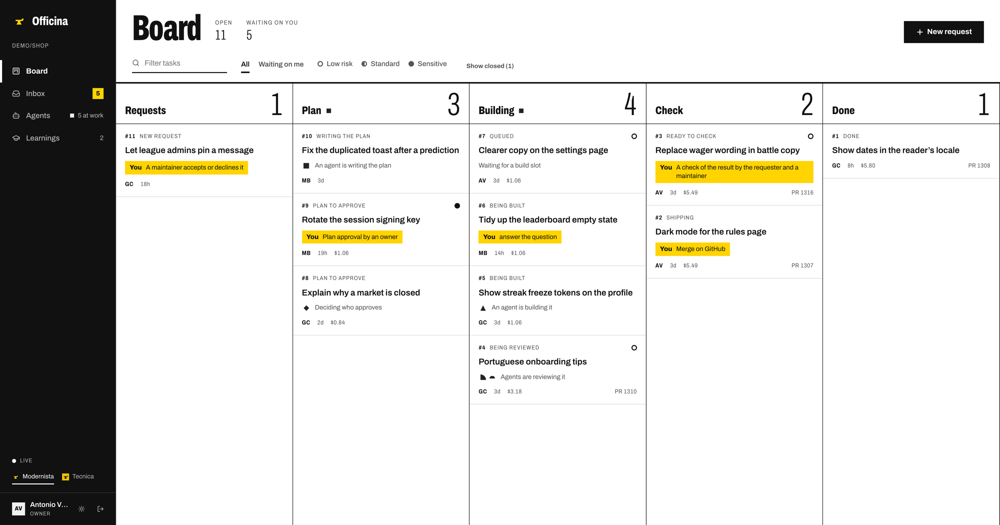
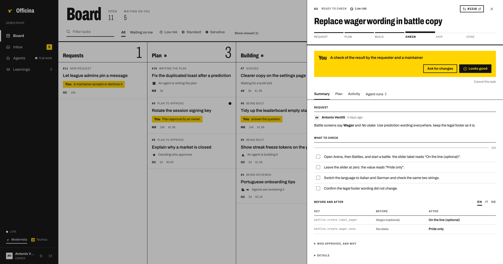
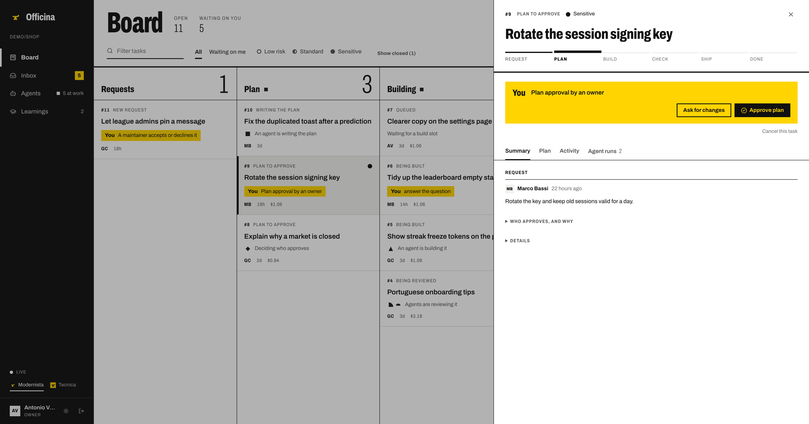
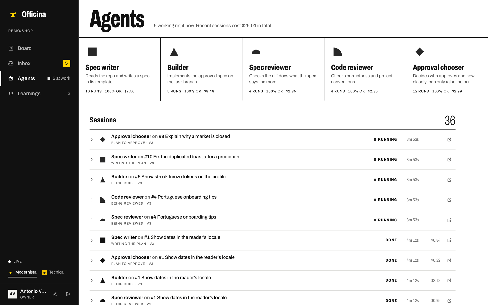
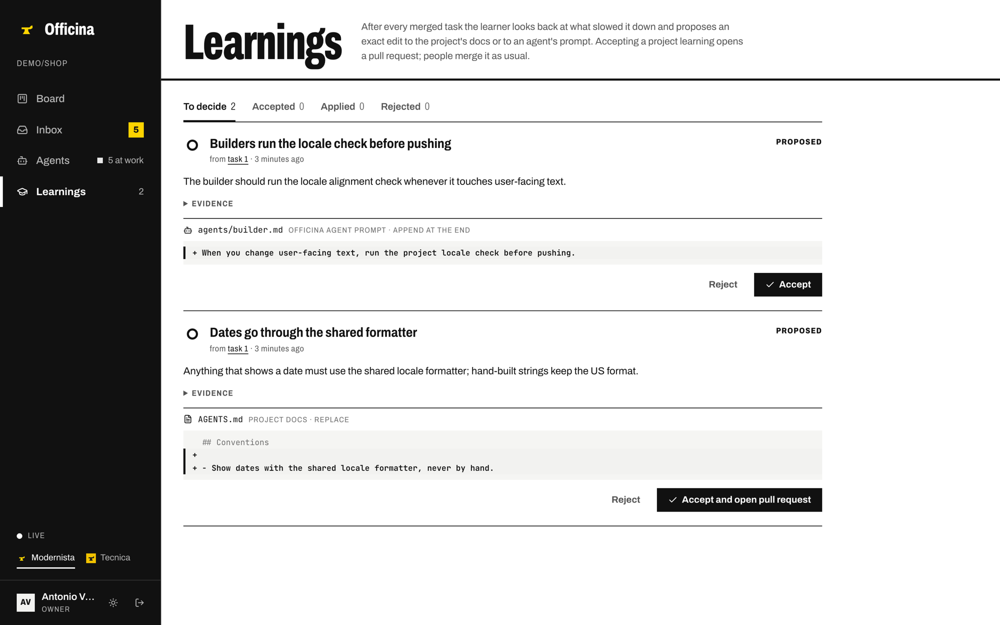
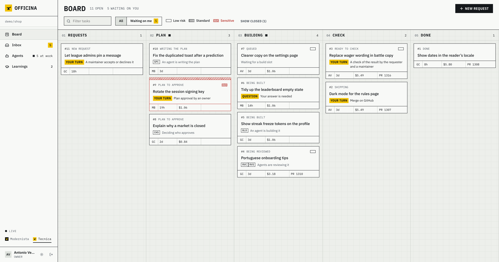
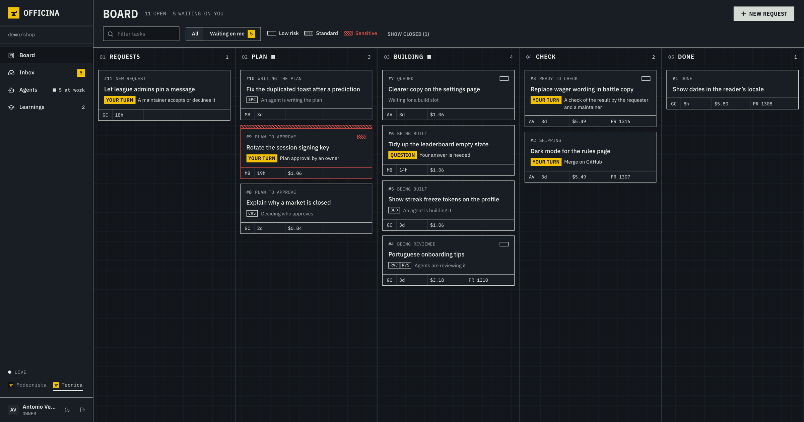

<div align="center">

#  Officina

### From a plain-language request to a merged pull request.

### 🛠️ A software workshop where agents do the work and people make the calls.

Anyone on the team describes what they need. Agents **interview, spec, build and review** it; the right people **approve, verify and merge**. Developers and non-developers share one board, one thread per task and one audit trail.

[Architecture](./docs/architecture.md) · [Running a task](./docs/running-a-task.md) · [Deployment](./docs/deployment.md) · [AGENTS.md](./AGENTS.md) · [Security](./SECURITY.md)

[](./LICENSE)
[](https://github.com/AntonioVentilii/officina/actions/workflows/ci.yml)


<br />

<picture>
  <source media="(prefers-color-scheme: dark)" srcset="./docs/assets/board-dark.png" />
  
</picture>

</div>

---

## Review is the bottleneck, not typing

Coding agents can write more code than any team can safely read. Officina is built around the other side of that equation: **human minutes per merged change**.

A request goes in as a sentence. An interviewer agent asks the follow-up questions a developer would. A spec agent writes the plan, people approve it, a builder implements it on its own branch, two independent reviewers check it, and a chooser decides **who** needs to look at the result and **what exactly** they should check. Nobody reads a diff they do not need to read, and nothing ships that the right people did not say yes to.

> Like a kanban where the cards spec, build and review themselves, but every gate that matters belongs to a person.

---

## The flow

```
  ①  Request          ②  Plan                 ③  Build               ④  Check               ⑤  Ship
  ──────────          ──────────────          ─────────────          ────────────           ──────────
  "Battle screens  →  Spec agent writes   →   Builder pushes     →   Chooser picks      →   Code owner
   still say           the spec; people        officina/12-*;         verifiers and a        merges; the
   Wager"              approve the exact       two reviewers          checklist; people      learner
  Interviewer asks     version                 check it against       verify in the          proposes what
  what's missing                               spec and for bugs      product                to improve
```

A maintainer can **claim the build** from the agent, before it starts or while it runs, and hand it back. Every event records who did it: a person, or an agent role at a specific version.

---

## What makes it different

|                                   |                                                                                                                                                                                                              |
| --------------------------------- | ------------------------------------------------------------------------------------------------------------------------------------------------------------------------------------------------------------ |
| 👥 **Collaborative first**        | One shared board, one thread per task, approvals by policy, an inbox of what is waiting on you. A single-user flow is just a team of one.                                                                    |
| 🚦 **Mechanical risk lanes**      | Path globs in `.github/officina.yml` put every change in a lane (`green`, `standard`, `red`), recomputed from the **real diff** after every build round. The stricter lane wins; a model never decides risk. |
| ✅ **People decide, agents do**   | The spec is always a human decision, and so is the result, unless a project explicitly lets low-risk changes through. Agents never merge and never approve their own work.                                   |
| 🎯 **Checks, not diffs**          | The chooser turns a change into a short checklist for the right people: "open Battles, the label reads _On the line_". Text changes come with before/after tables in every locale.                           |
| ⚙️ **Deterministic engine**       | Scheduling, state transitions, leases, budgets, retries and recovery are plain code. Models run only inside stage agents and return typed contracts the engine validates.                                    |
| 🔐 **No keys to steal**           | Production holds no Anthropic API key: the Fly machine proves its identity with OIDC and gets a short-lived token. GitHub tokens are scoped to one repository and the permissions a role needs.              |
| 🐙 **GitHub stays the authority** | Officina opens branches and pull requests through its GitHub App and respects your CI and branch rules. Reviews left on GitHub flow back to the builder; approvals can be submitted as the verifier.         |
| 🧪 **It learns from every merge** | After each task the learner looks at what slowed it down and proposes an exact edit to the project docs or an agent prompt. People accept it, and it lands as a pull request.                                |
| 💸 **Budgets per lane**           | Each lane caps work in progress, diff size and spend per step. Every task shows what its runs cost.                                                                                                          |

---

## See it in action

### Verify a result without reading code

<div align="center">
  
</div>

The chooser decided this text change needs the requester and one maintainer, at a glance. They tick the checklist and press **Looks good**; the engine approves the pull request as them and turns on auto-merge.

### Approve the plan before anything is built

<div align="center">
  
</div>

A change touching sensitive paths needs an owner's approval of the exact spec version. Asking for changes sends it back to the spec agent with your comments.

<table>
<tr>
<td width="50%"><br/><sub><b>Agents</b>: every role has a shape; every session is live, with its cost</sub></td>
<td width="50%"><br/><sub><b>Learnings</b>: proposed edits, accepted by people</sub></td>
</tr>
</table>

### Two looks, light and dark

Pick one in the sidebar footer, or set a project default with `board.look` in `.github/officina.yml`. **Modernista** is a strict grid with big numerals and a shape for every agent. **Tecnica** treats every task as a work order on a technical drawing, with risk drawn as hatching. In both, yellow means one thing only: it is your turn.

<table>
<tr>
<td width="50%"><br/><sub><b>Tecnica</b>, light</sub></td>
<td width="50%"><br/><sub><b>Tecnica</b>, dark</sub></td>
</tr>
</table>

---

## The crew

Each role is a versioned prompt in [`agents/`](./agents), synced to Claude Managed Agents on boot. Changing a prompt creates a new agent version; every run records the version it used.

| Role                                                        | Does                                                                               | Can write? |
| ----------------------------------------------------------- | ---------------------------------------------------------------------------------- | :--------: |
| 🎤 [Interviewer](./agents/interviewer.md)                   | Asks the requester up to four questions until the request is specific              |     no     |
| 📝 [Spec](./agents/spec.md)                                 | Reads the repo and writes a spec with file scope and a predicted lane              |     no     |
| 🔨 [Builder](./agents/builder.md)                           | Implements the approved spec on the task branch and runs the project's checks      | its branch |
| 📏 [Spec reviewer](./agents/reviewer_spec.md)               | Checks the diff does what the spec says, no more                                   |     no     |
| 🔍 [Correctness reviewer](./agents/reviewer_correctness.md) | Checks correctness and project conventions, independent of how the change was made |     no     |
| 🧭 [Chooser](./agents/chooser.md)                           | Decides who approves and how closely; it can only raise the bar                    |     no     |
| 🎓 [Learner](./agents/learner.md)                           | Looks back at a merged task and proposes what the project should learn             |     no     |

---

## Quick start

You need [Bun](https://bun.sh) 1.3+ and Docker.

```bash
bun install
bun run dev        # throwaway Postgres, the API on :8080, a demo workshop and simulated agents
bun run dev:board  # the board on http://localhost:5173
```

The first command prints a one-time sign-in link. The demo has a task in every stage and agents that keep working, so you can click through the whole flow without any API key.

Checks:

```bash
bun run lint && bun run typecheck
bun run test       # core, GitHub and runner: no network, no database
bun run test:db    # database, engine and API against a throwaway Postgres
```

## Bring your own repository

1. Create a GitHub App with contents, issues and pull requests read/write, checks and metadata read-only (no Actions, Workflows or Administration), subscribed to `check_suite`, `issue_comment`, `issues`, `pull_request`, `pull_request_review` and `push`, and install it on the repositories you want.
2. Deploy the API (a `Dockerfile` and `fly.toml` are included) with the secrets listed in [docs/deployment.md](./docs/deployment.md).
3. Add a `.github/officina.yml` to the repository: docs entry point, verify commands and the lanes with their approval policies ([format](./docs/architecture.md#11-project-config)).
4. Register it and invite your team:

```bash
bun apps/api/src/cli.ts add-project --workspace acme --repo acme/shop --owner-email you@acme.dev --owner-name You
bun apps/api/src/cli.ts invite --email giulia@acme.dev --name "Giulia" --role contributor --domains product
```

Protect your default branch and tags with a ruleset the App cannot bypass: Officina assumes branch rules are the final authority and never works around them. [Running a task](./docs/running-a-task.md) walks through one change end to end.

---

## Status

Early preview. Phase 0 of the [roadmap](./docs/architecture.md#14-phases) is running in production for one team: engine, GitHub App, Managed Agents runner, all seven roles, the board, approvals and learnings. Next: email sign-in, notifications, multiple projects per workspace and a self-hosted runner.

Officina is built to be built with Officina. [`AGENTS.md`](./AGENTS.md) is the entry point for agents working on this repository, and [`docs/architecture.md`](./docs/architecture.md) is the source of truth for the design.

## Security

Please report vulnerabilities privately, as described in [SECURITY.md](./SECURITY.md).

## License

[MIT](./LICENSE)
